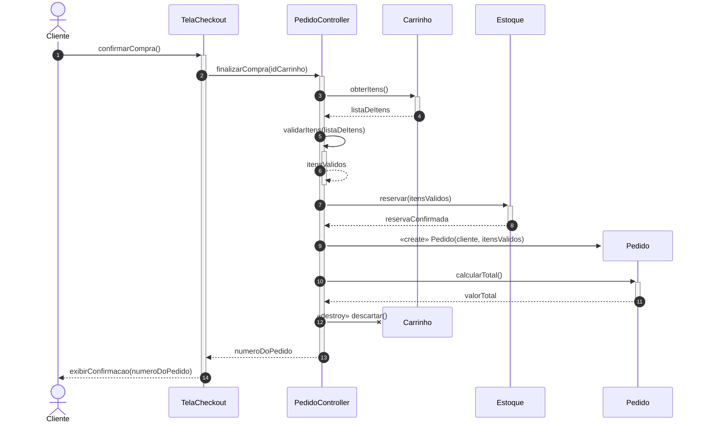
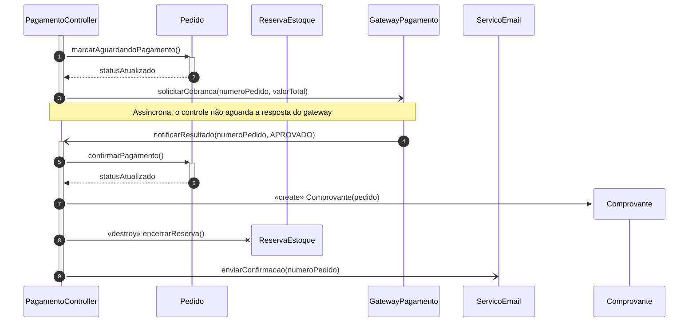

# Criação e destruição de objetos e mensagens síncronas e assíncronas em uma loja virtual

**Disciplina:** Engenharia de Software (PRES_80_200) – UniCesumar – 2026/2
**Integrantes:** NOME DO ALUNO 1 e NOME DO ALUNO 2
**Tema 3:** Diagrama de sequência – criação e destruição de objetos, mensagens síncronas e assíncronas

## Cenário
Loja virtual de eletrônicos. O cliente finaliza a compra: o sistema valida os itens, reserva o estoque, cria o pedido, calcula o total e descarta o carrinho. O pagamento é cobrado por um gateway externo de forma assíncrona; ao ser aprovado, o pedido é confirmado, um comprovante é criado, a reserva de estoque é encerrada e um e-mail é enviado de forma assíncrona.

## Arquivos
- Trabalho escrito (PDF): [docs/trabalho_diagramas_de_sequencia.pdf](docs/trabalho_diagramas_de_sequencia.pdf)
- Diagrama 1 – Finalização da compra: [fonte .mmd](diagramas/diagrama1_finalizar_compra.mmd) · [PNG](diagramas/diagrama1_finalizar_compra.png) · [SVG](diagramas/diagrama1_finalizar_compra.svg)
- Diagrama 2 – Pagamento assíncrono: [fonte .mmd](diagramas/diagrama2_pagamento_assincrono.mmd) · [PNG](diagramas/diagrama2_pagamento_assincrono.png) · [SVG](diagramas/diagrama2_pagamento_assincrono.svg)

## Ferramenta CASE
Mermaid (diagramas escritos em texto e exportados em PNG e SVG).

## Diagrama 1 (renderizado pelo GitHub)

## Diagrama 2 (renderizado pelo GitHub)

